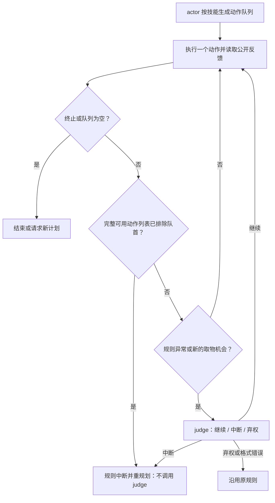

# 模型 Judge 低成本检查验证

日期：2026-10-10。用户累计费用上限提高到 **200 美元**。

## 结论

已实现独立 judge 接口，支持相同 API 模型的不同角色提示词，也支持另配 judge 模型。
本轮实际使用同一个 `qwen3.6-35b-a3b`，分别调用 actor 与 judge；没有实验验证另一个模型。
这属于角色分离的固定提示词对照，**不是原版 SkillOpt 新增了在线 judge，也不是已经学会的检查器**。

10 个新场景、三组共 30 回合：原规则 **2/10**，简短 judge **2/10**，依赖 judge **3/10**。
依赖组为 2 胜、1 负，未通过原先冻结的“不丢失原本成功题”门槛。简短组有一次 actor 输出格式错误。
无候选接受，另 10 题确认集没有执行，没有最终测试。**不能宣称已获得稳定或可归因的 interrupt gain。**

新增付费请求 **236 次**，全部返回 usage，无新增未知费用；新增保守费用 **$11.690500**。
累计 **$133.202250 / $200**，剩余 **$66.797750**。历史费用和未知用量预留全部保留。
这仍是保守客户端账本口径，不是服务商发票。

## 当前执行方式

图中“完整列表排除队首直接规则处理”是付费实验后加入的 **v2 修复**；本轮付费 **v1** 在这个位置也询问 judge。
v1 的配置和源码快照保留原样。v2 在三组中共同启用该规则，避免把机械修复的收益记到 judge 名下。
当前中断仍清空剩余队列；尚未升级为删除单个证伪动作并保留无依赖队尾。

judge 只读取任务、最新动作/反馈、剩余队列、当前可用动作与最多 8 步公开历史。
不读取隐藏状态、任务答案、未来结果或其他分支结果，也不执行动作。终止和空队列不调用 judge。
defer 或格式错误回退原规则，已经产生的调用和费用仍然计数；预算/网络错误会停止批次。

两个固定提示词：brief 判断队列是否仍适合当前任务；dependency 强调已证伪前提、动作依赖与独立队尾。
本轮没有用失败反思在线修改提示词。要把 judge prompt 纳入 SkillOpt 学习，需要另设训练证据、候选筛选和独立确认，不能把这次选择集改成未暴露测试。

## 公平性与样本

三组技能文本、actor 提示词、模型、原始操作器、temperature=0、环境 seed=42 相同。
每题共同上限为 **actor + judge 合计 8 次模型调用、40 个动作**；judge 最多 4 次、每次输出 128 token，并为后续 actor 保留至少 1 次调用。
actor 全部使用 1024 输出 token；不能直接与上一轮不同任务、512 token 上限的 5/10 对比。

选择集来自 `valid_seen`，简单放置、清洗、加热、冷却、双物体各 2 题。
按固定种子和任务类别轮换抽样，排除历史结果及配置出现的场景目录；每题轮换三组执行顺序。
另外预留 10 题确认，未执行。场景目录不同不代表房间布局完全独立；没有跨环境或新布局泛化结论。

10 题的三组初始观察、任务、可用动作和 gamefile 记录完全一致。
模型 temperature=0 仍不能保证每次输出相同，因此任务配对不是固定动作前缀的因果对照。

## 十题完整回合结果（付费 v1）

| 指标 | 原规则 | brief judge | dependency judge |
| --- | ---: | ---: | ---: |
| 成功 | 2/10 | 2/10 | 3/10 |
| actor 调用 | 74 | 67 | 71 |
| judge 调用 | 0 | 4 | 4 |
| 总模型调用 | 74 | 71 | 75 |
| 环境动作 | 82 | 75 | 82 |
| 非法动作 | 9 | 4 | 6 |
| judge 改变原规则的次数 | 0 | 1 | 1 |
| 实际队尾截断 | 4 | 1 | 0 |
| 总费用 | $3.816050 | $3.357250 | $3.516475 |
| 其中 judge 费用 | $0 | $0.091525 | $0.088125 |

brief 在 `selection-01` 第 4 次 actor 请求缺少 `</thought>`，含模板标签，违反 thought/actions 协议。
该请求 finish_reason=stop、输出 787 token，**不是截断**；失败保留，没有自动修复或重跑。
8 次 judge 输出均符合 JSON 协议；格式正确不代表判断正确。

dependency 的两胜为 04、07，一负为 06。07 的 dependency 回合完全没有调用 judge，06 也没有调用；
这些差异不能归因于中断判断。04 虽有一次改判，但那次放行的动作实际被拒绝，后续成功不能反证改判正确。
共同成功题只有 00，dependency 反而多 1 次总调用、费用多 $0.047025。

两种 judge 的 20 个回合共只有 21 个非终止非空队尾，门控命中 10 次，其中 2 次因需保留最后一次 actor 调用而不再检查。
实际查询 8 次、改判 2 次：短队列/单动作倾向仍使可学习和可节省的机会很少。

## 成本与核心 bug

本轮 judge 平均每次约 **$0.02246**，actor 平均约 **$0.04958**；短上下文、短输出确实降低了单次调用费用。
但 judge 是额外调用，且会占用总调用额度。单次便宜不等于整个流程更便宜或更容易成功。
8 次 judge 总输入 5176 token、输出 335 token，总调用延迟约 12.95 秒。

judge 返回 7 次 continue、1 次 interrupt。**7 次 continue 的下一条动作都不在当前可用动作列表，执行后全部得到 Nothing happens。**
典型错误包括把 `put` 当作可直接执行的 `move`，或忽视已持有第一块肥皂时无法再拿第二块。
同模型改角色可以缩短输入与输出，但本轮仍表现出与 actor 相似的动作接口误解；不能把“独立请求”当成独立正确的验证器。

v2 因此加入 `authoritative_admissibility`：只有接口声明列表完整时，缺失的**队首**才构成硬否决，零模型调用处理。
后续动作现在不在列表不构成证伪，前面的动作可能建立其前提；部分提示列表不能启用该硬否决。
规则基线和 judge 组都共享这项检查。该修复在上述 7 个真实前缀重放中验证，零 API 请求；**未做修复后新 10 题付费验证，不能宣称其端到端 gain。**

## 两个真实改判前缀的恢复对照

在完整回合结束后，按“每个任务/角色最早一次实际改判”取全部 2 个案例，不按成功结果挑选。
冻结后分别重放初始状态、每一步动作/可用动作/反馈与原队列，再运行继续原队尾和中断重规划。
两臂后续均使用相同原规则控制器，每臂 4 次 actor 调用、16 步，交替执行顺序，无额外 judge。
这是开发诊断，不是独立测试；每分支只运行一次，仍有随机性。

| 前缀 | 继续队尾 | 中断重规划 | 结论 |
| --- | --- | --- | --- |
| 04 dependency：继续拿第二块肥皂 | 失败，4 调用、5 步、2 非法、$0.238875 | 失败，4 调用、4 步、0 非法、$0.236850 | 两边失败，收益未知；放行并未避免非法动作 |
| 06 brief：打开抽屉后跳过 examine | 成功，4 调用、9 步、$0.257950 | 成功，4 调用、7 步、$0.267050 | 中断省 2 步，但并未省调用，费用略高 |

第二例再计入历史 judge 的 1 次调用与费用，中断侧为 5 次总调用，仍无调用/费用净收益。
历史 judge 费用仅用于比较，不在账本重复收费。两个分支 checkpoint hash 均逐对一致。
不能把额外恢复预算下的成功记为原完整回合成功。

## 代码、验证和证据

- 组件：`dynamic_skill/controllers/judge.py`，既有执行器的可选检查层，原迁移文件未改。
- 实验：`experiments/alfworld/judge_interrupt/`，包含配对试验、固定前缀诊断及方法说明。
- 完整回合：`results/alfworld/judge_interrupt/20261010_same_model_10/`。
- 前缀恢复：`results/alfworld/judge_interrupt/20261010_disagreement_prefixes/`。
- 审计汇总：`results/alfworld/judge_interrupt/20261010_summary/`，含账本、角色费用、初始状态配对、7 前缀离线修复验证。
- 完整离线检查：**295 passed，5 skipped**。包含同模型角色、共享总调用预算、真实队列效果、原提示词一致性、格式/网络失败处理、硬事实优先和不误判后续动作。

30 回合：220 请求、$10.689775；4 个恢复后缀：16 请求、$1.000725。
两批均关闭授权，无 pending。临时实验代理在完成后清理；没有修改共享代理。

下一步应先以带硬事实检查的规则作为共同基线，收集其仍判断错误的语义/依赖前缀，再考虑训练 judge prompt 或替换独立模型。
不要用“episode 失败”直接给 judge 标错，也不要把机械过滤已知非法命令当作 learned interrupt 的收益。
